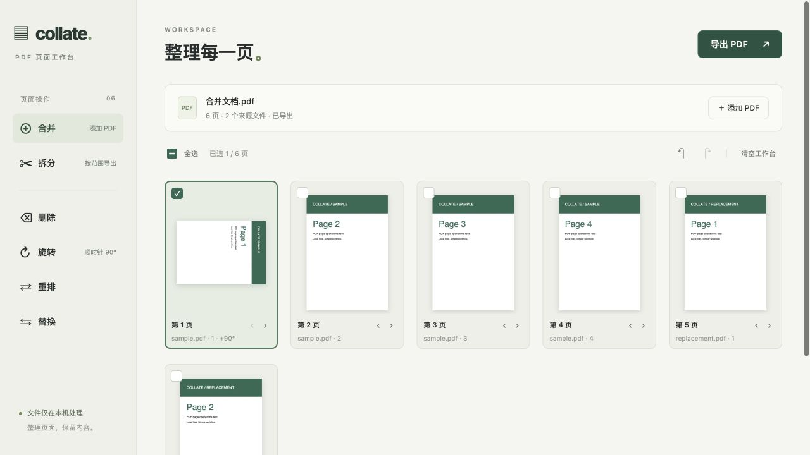

# Collate

English | [简体中文](README.zh-CN.md)

A local PDF page editor built with [MyGo](https://github.com/egoist/mygo).

## Features

- **Merge** multiple PDFs into one document.
- **Split** a PDF by page ranges or into individual pages.
- **Delete** selected pages.
- **Rotate** selected pages in 90° increments.
- **Reorder** pages by dragging, moving, or entering a page sequence.
- **Replace** selected pages with pages from another PDF.

Preview page thumbnails, select pages in batches, and undo or redo changes. PDF files are processed locally on your device.

## Screenshot

## Permissions and first-launch limitations

- **Requirements:** macOS 15+ or Windows x64. No Go, Bun, or Node.js installation is needed. The Windows installer includes an offline WebView2 Runtime installer and installs it when needed.
- **GitHub Actions:** builds require no additional signing secrets in the current configuration. Only the Release publishing job uses the built-in `GITHUB_TOKEN` with `contents: write`; other jobs have read-only repository access. Your repository or organization must allow these Actions permissions.
- **macOS:** the app currently uses ad-hoc signing and is not notarized by Apple. Gatekeeper may block it when first opened after downloading.
- **Windows:** the app and installer currently have no publisher code signature. Windows may show an unknown-publisher or SmartScreen warning.

A warning-free first launch cannot be guaranteed until Developer ID signing and notarization for macOS, and publisher code signing for Windows, are configured and verified.

## License

Licensed under the [MIT License](LICENSE).
